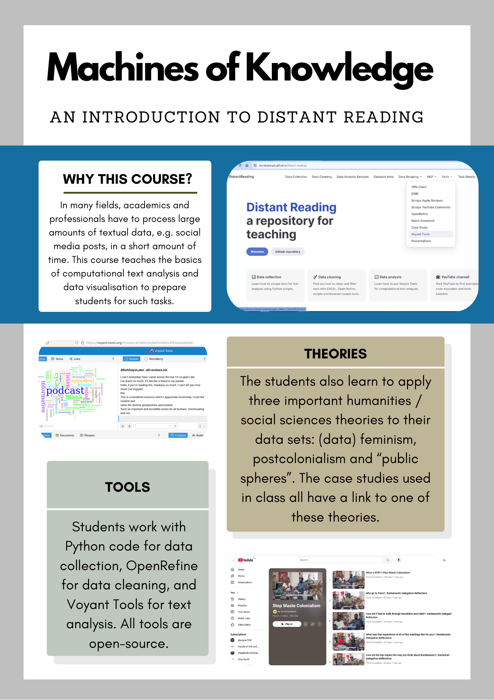

## Machines of Knowledge - a distant reading course at Maastricht University

### What the course is about...

 

**Figure 1:** Overview of the “Machines of Knowledge” course framework.

The term "distant reading" (Franco Moretti) is often used to describe computator-assisted and often statistical text analysis as opposed to human-performed *close reading*. A basis of distant reading is machine-readable text, which is why this repository also provides materials on (automated) data collection for academic purposes. The focus is on natively digital text in the form of social media posts, comments and reviews, but distant reading can also be applied to retro-digitised materials. 

### Some suggested readings

- Aurnhammer, C., Cuppen, I., van de Ven, I., & van Zaanen, M. (2019). Manual Annotation of Unsupervised Models: Close and Distant Reading of Politics on Reddit. *DHQ: Digital Humanities Quarterly, 13*(3).
- Bludau, M.-J., Brüggemann, V., Busch, A., & Dörk, M. (2020). Reading traces: Scalable exploration in elastic visualizations of cultural heritage data. *Computer Graphics Forum, 39*(3), 77–87. https://doi.org/10.1111/cgf.13964
- Caulfield, J. (2019, November 8). *Textual Analysis | Guide, 3 approaches & examples.* Scribbr. https://www.scribbr.com/methodology/textual-analysis/
- Clavert, F., & Fickers, A. (2018). On pyramids, prisms, and scalable reading. *Journal of Digital History, 1*(1). https://journalofdigitalhistory.org/en/article/jXupS3QAeNgb
- COST Association. (2022, September 12). *Changing the way European literary history is written with distant-reading.* COST. https://www.cost.eu/distant-reading/
- Drakman, A., & Gelfgren, S. (2023). How to combine close and distant reading within the history of science and ideas: Two examples from ongoing research. *Lychnos, 2022,* 85–108. https://doi.org/10.48202/24128
- Fleming, P. (2017). Tragedy, for example: distant reading and exemplary reading (Moretti). *New Literary History, 48*(3), 437–455. https://doi.org/10.1353/nlh.2017.0021
- Gabi, K. (2022). Computation as Context: New Approaches to the Close/Distant Reading Debate. *College Literature, 49*(1), 1–25. https://doi.org/10.1353/lit.2022.0000
- Jänicke, S., Franzini, G., Cheema, M. F., & Scheuermann, G. (2015). On close and distant reading in digital humanities: A survey and future challenges. *Eurographics,* 83–103. https://doi.org/10.2312/eurovisstar.20151113
- Roskos, K., & Neuman, S. B. (2014). Best practices in reading: A 21st century skill update. *The Reading Teacher, 67*(7), 507–511. http://www.jstor.org/stable/24573611
- Taylor, J. E., Gregory, I. N., & Donaldson, C. (2018). Combining close and distant reading: A multiscalar analysis of the English Lake District’s historical soundscape. *International Journal of Humanities and Arts Computing, 12*(2), 163–182. https://doi.org/10.3366/ijhac.2018.0220
- Weitin, T. (2017). Scalable reading. *Zeitschrift für Literaturwissenschaft und Linguistik, 47*(1), 1–6. https://doi.org/10.1007/s41244-017-0048-4
